# A reader's report on 31:11: the superscript alef in ضَلَـٰلٍ

Written 7 November 2026 for Mohamed, corrected the same day after the Lead's independent check. Branch `fix/quran-31-11`, off `main` bcafdfa9, which is the build the reader has. Nothing is merged or pushed. Images are in [2026-11-07-quran-31-11/](2026-11-07-quran-31-11/). The full-size screenshots are in `~/Desktop/Workspace/apps/.quran-31-11-evidence/`.

## Verdict

**The reader is correct.** The letters and the alef are right in the text, and the drawing is wrong.

The alef is in the database and the app does draw it, but outside the word: on the baseline, to the left of the last letter. So the word reads ضَلَلٍ with a stray tick after it. It isn't a font replaced by the OPPO, and it isn't one word. It reproduces on a stock API 33 emulator and shows in our own Play and App Store screenshots.

**It affects 322 distinct words: 1,333 occurrences on 508 of the 604 pages, and the basmala's ٱلرَّحْمَـٰنِ above nearly every surah.**

**The root cause reaches further than this word.** This font expects King Fahd's encoding of the Quran, and we feed it Tanzil's. The misplaced alef is the worst result for the reader's word, but the same mismatch makes the app differ from the print in other marks. Those are listed under [Other differences from the print](#other-differences-from-the-print), and none is fixed here. "Correct" below means the alef and nothing wider.

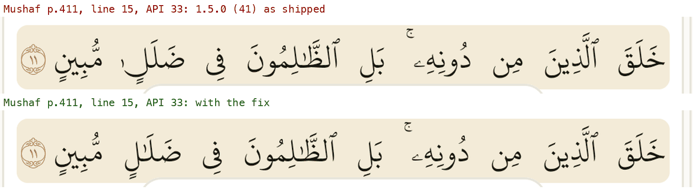

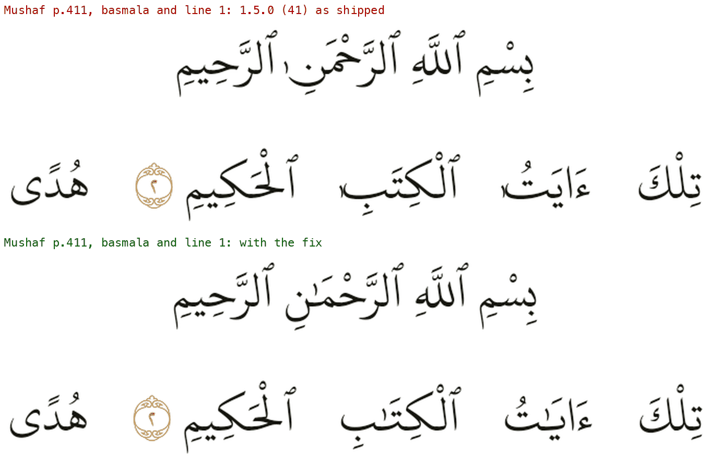

## The text: code points of the word

| Source | Code points | |
|---|---|---|
| `quran.db` in `build-41` and `main` (`ayah`, `line_word`, `page_line`) | 0636 064E 0644 064E **0640 0670** 0644 064D | U+0670 present, on a tatweel |
| Tanzil, our cached `uthmani.txt` (sha d637b2ba), and a fresh download | same | |
| Mushaf layout source, `page-411.json` | same, then 06E2 | |
| quran.com `text_uthmani` | same | derived from Tanzil, so not independent |
| **King Fahd Complex's text** (quran.com `text_qpc_hafs`) | 0636 064E 0644 064E **0670** 0644 0656 | independent: alef, no tatweel |
| Page images of the printed layout: [files.quran.app p.411](https://files.quran.app/hafs/madani/width_1024/page411.png), alim.org p.411 | | the alef sits above the join of the two lams. Line 15 breaks where our database does |

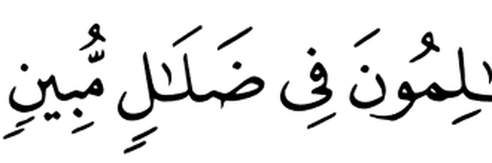

Limit: "print" in this report means page images. They look like King Fahd typesetting, but neither source says it is a camera scan of paper, and they aren't independent of each other. I found no archive.org scan of this page. The King Fahd text comes through quran.com's API, not from a file of the Complex.

### What the stored text is

`quran.db` is not Tanzil's bytes. Earlier versions of this report said it was, and that was wrong:

- The pipeline maps every U+06DF to U+0652 (`tools/build-quran-db.py:206`): 3,988 marks in 2,240 ayahs. Our design spec records this (§3.2 rule 2), but the licence credit doesn't.
- It strips the basmala from the first ayah of each surah that carries it in Tanzil's file.
- Undoing those two reproduces Tanzil's `tatweel=false` download in all 6,236 ayahs.

Copy and share hand out that stored text. This branch changes none of it.

### A pipeline finding

Our spec (§3.1) says "no tatweel", and `tools/build-quran-db.py` asks for `tatweel=false`. Tanzil treats any value as on: `tatweel=false` and `tatweel=true` give the identical file (sha d637b2ba). Leaving the parameter out gives sha 22200471, which is the same file with every U+0640 before U+0670 removed and nothing else changed (checked by script). So the database has carried these tatweels since September by accident, and this is one way the font and the text disagree.

## The mechanism

Measured from the font's own tables (KFGQPC HAFS Uthmanic Script, version 2.2, the same file on Android and iOS):

1. `calt` lookups 16 and 55 merge a tatweel and a final letter into one kashida glyph (k53, k57, k93, k97…). They ignore marks, so they reach straight past the U+0670 between them.
2. The alef then attaches to that glyph. GPOS lookup 14 gives most of them a placeholder anchor of (0,0) for the alef's class. Its own anchor is (275,0), so it lands at (−275, 0): on the baseline, outside the word.
3. The King Fahd text has no U+0640 at all before U+0670 (0 in the Quran), so it never reaches these glyphs.

Eleven kashida glyphs can carry an alef, and all eleven are wrong:

| Glyph | Final letter | Tokens | What the reader sees |
|---|---|---|---|
| k53, k57, k61, k69, k81, k85, k89, k93, k97 | ب ت ث ش ف ق ك ل ن | 1,320 | alef on the baseline, outside the word |
| k121 | ن after ب ت ي | 6 | alef over the noon. In 24:16 and 61:4 it runs into the dammatan, an unreadable blot |
| k101 | ى | 7 | alef crosses the fatha and reads like ٢ |

The second and third rows were caught by an independent check, not by me.

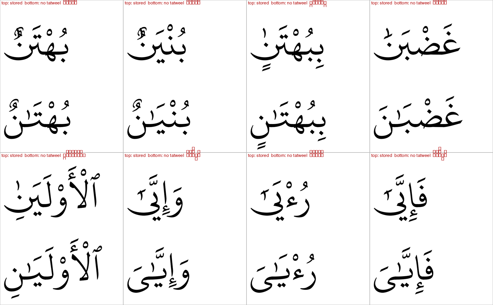

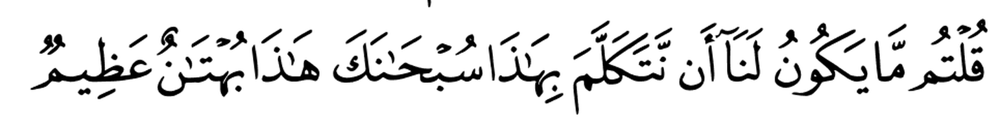

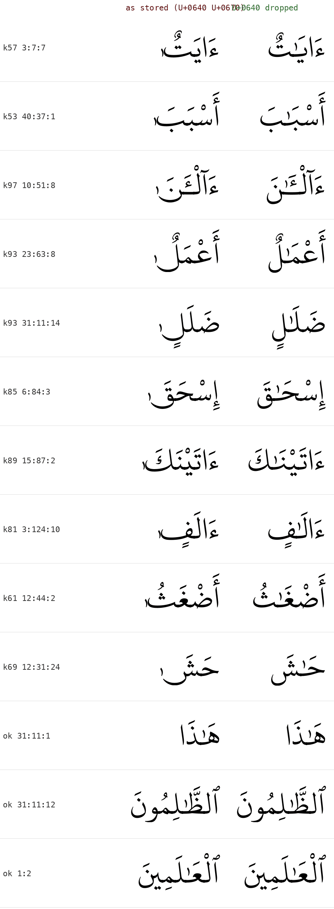

Every OpenType shaper follows these tables. Measured for the word:

| Shaper | Used by | Result |
|---|---|---|
| HarfBuzz 14.6 | command line | (−275, 0) |
| JDK's text layout | the new test | same fault |
| CoreText, macOS | stands in for the iOS widget | same fault |
| Minikin on API 33 | Android app | seen in screenshots |
| Skia on iOS | iOS app | seen in the App Store shot of page 42 |

**Ruled out:** a font without U+0670 (it has the glyph), a fallback to the system font (every surface below uses the bundled font), line-height clipping (the mark isn't clipped, and it's far from any edge), text split into runs (the search highlight colours whole words; colour does not break shaping), tatweel handling in our code (there was none), and the font and size settings (the fault is the same at every size).

## The surfaces

All of them use the bundled font except where noted. The 13 call sites are pinned by a test.

| Surface | File | Font and engine | Before | After |
|---|---|---|---|---|
| Mushaf page | `MushafPageView.kt` | Hafs, Compose (Minikin / Skia) | **wrong** | fixed, API 33 + iOS |
| Mushaf basmala line | `MushafPageView.kt` | same | **wrong** | fixed, API 33 + iOS |
| Reader ayah | `AyahCard.kt` | same | **wrong** | fixed, API 33 + iOS |
| Reader basmala | `ReaderScreen.kt` | same | **wrong** | fixed, API 33 |
| Search hit and highlight | `QuranRootScreen.kt` | same | **wrong** | fixed, API 33 |
| Saved list | `QuranRootScreen.kt` | same | **wrong** where the first line holds such a word | same code path. The 31:11 row's first line has none, so not shown changing |
| Reading sheet preview | `ReadingSheet.kt` | same | 1:2 has no such word | goes through the rule |
| Adhkar passages and basmala | `AdhkarPage.kt` | same | **wrong** | fixed, API 33 |
| Settings widget preview | `AyahWidgetPreview.kt` | same | **wrong** | fixed, API 33 |
| Android ayah widget | `AyahCardRenderer.kt` | Hafs, StaticLayout | **wrong** | fixed, API 33 home screen |
| iOS ayah widget | `TaqwaAyahWidget.swift` | Hafs, SwiftUI / CoreText | **wrong** (CoreText) | fixed, iOS 26.2 simulator, debug preview route |
| Surah names, reciter monogram, player | several | Hafs | no U+0670 in any of the 114 names | untouched |
| Copy and share | `ReaderViewModel.kt`, `MushafViewModel.kt`, `AyahShareText.kt` | no font, plain text | the stored text | **unchanged, deliberately** |
| Adhkar duas, istiadhah, tasbeeh | `AdhkarPage.kt`, `TasbeehScreen.kt` | OS face | not Quran text | untouched |
| Watch (`watch-companion`) | | no Hafs surface and no such sequence | | nothing to do |

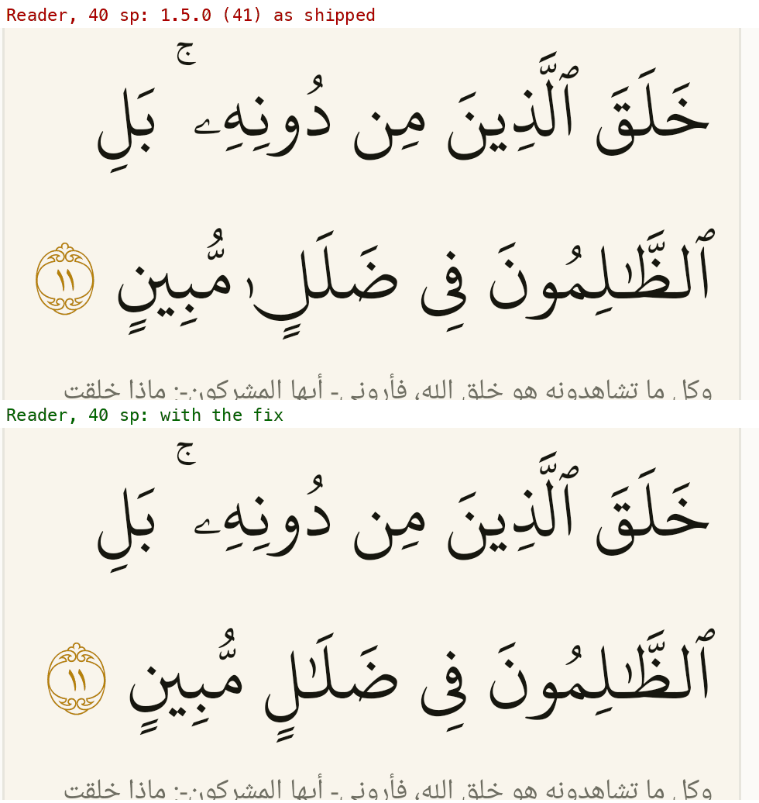

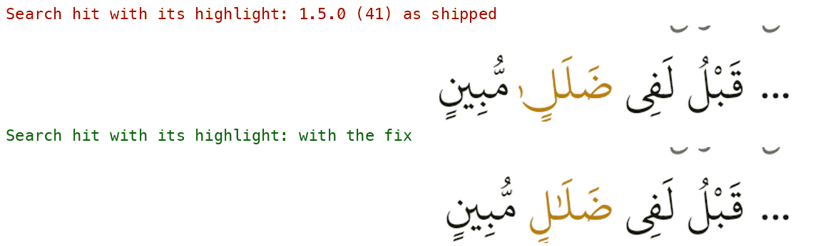

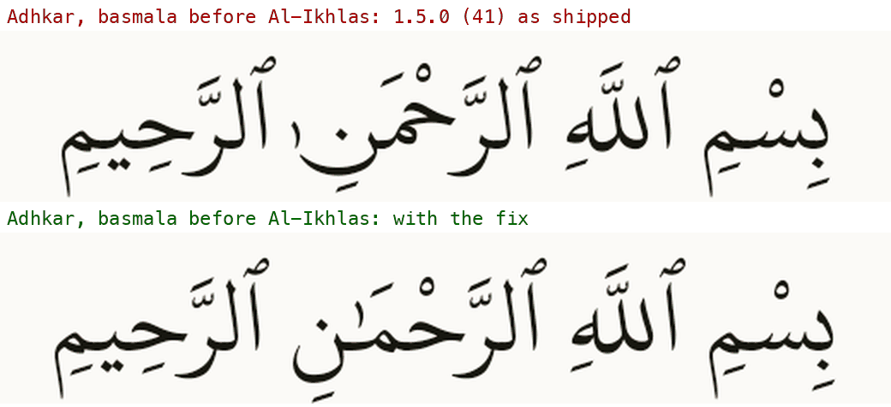

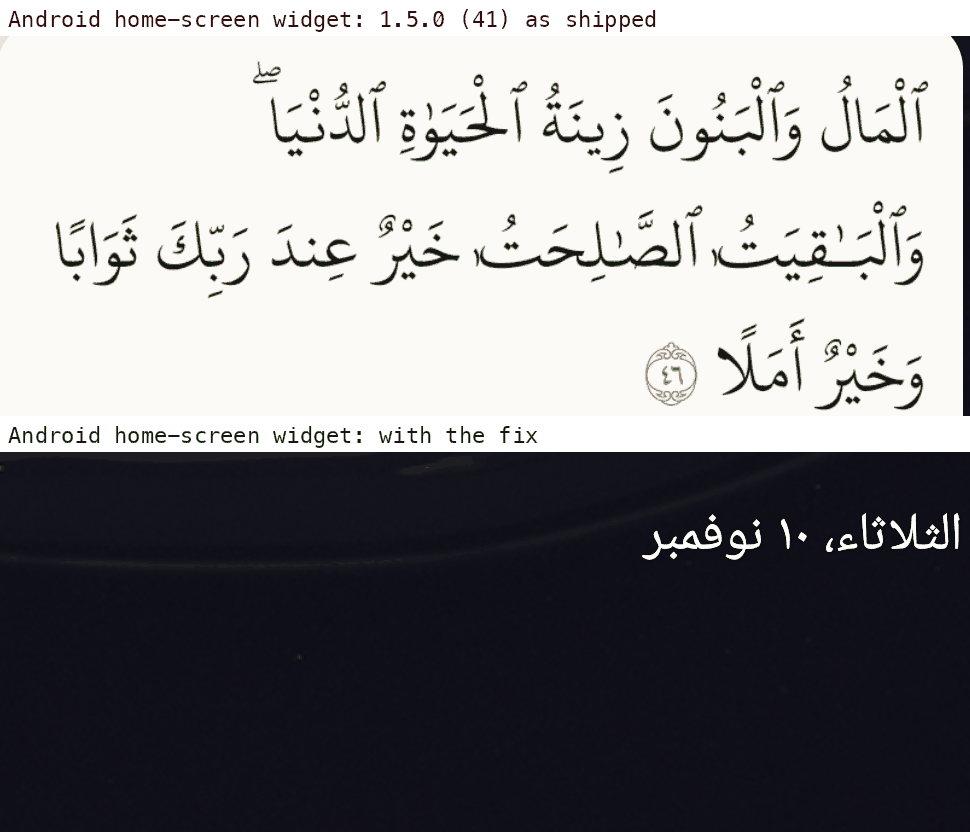

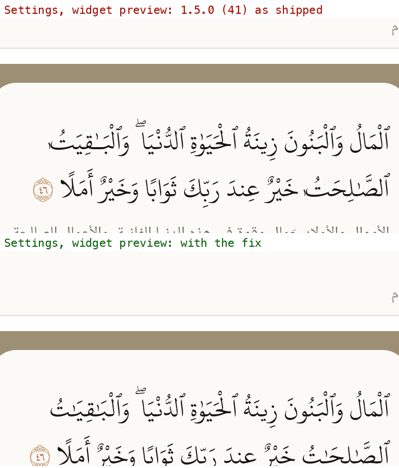

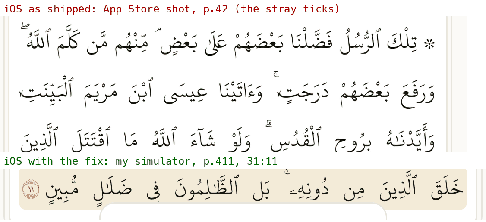

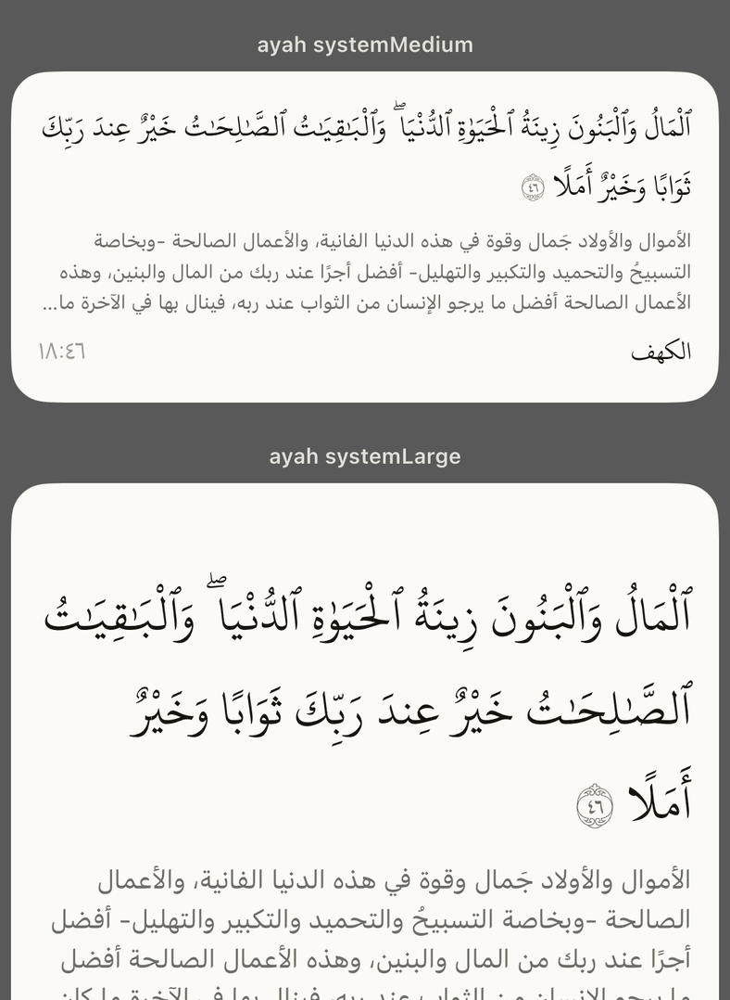

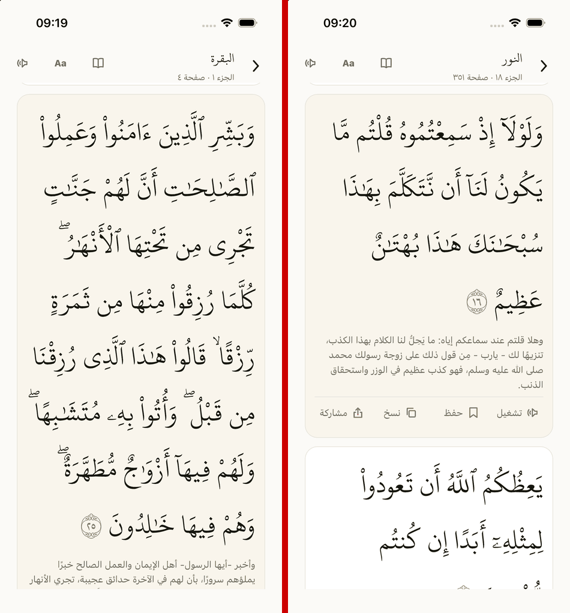

## The extent

Whole Quran, shaped word by word with the app's font:

| | |
|---|---|
| Words with U+0670 | 9,302 tokens |
| Tatweels before a U+0670 | 5,924 |
| **Misplaced** | **322 distinct words, 1,333 tokens** ([list](2026-11-07-quran-31-11/affected-words.tsv)) |
| Ayahs affected | 1,098 of 6,236, in 96 surahs |
| Mushaf pages affected | 508 of 604 (1,192 of 8,820 lines) |
| Basmala | the line above each surah that has one (112), the Reader's, and the Adhkar's |
| Ayah widget | 13 of the 100 pool ayahs |
| Most frequent | ٱلْكِتَـٰبَ 78, ٱلْكِتَـٰبِ 77, ٱلصَّـٰلِحَـٰتِ 59, أَصْحَـٰبُ 41, جَنَّـٰتٍ 37 |

Every surface draws the same stored text with the same font, so the same words are affected on each.

## The fix

`HafsSpelling.forDrawing` (in `:widgetcore`, because the iOS widget extension links only that) handles a word whose last letter comes straight after a tatweel and alef and is one of ب ت ث ش ف ق ك ل ن ى. It draws that word with every tatweel before an alef gone. All other words are drawn as stored. It is called at the point of drawing on every Hafs surface above.

**This is a rendering choice.** No letter or mark changes, only a stretching tatweel, and nothing stored changes. What holds, exactly:

| Claim | Measure |
|---|---|
| Words the rule touches equal the words the font misplaces | 322 and 322, no difference either way |
| Tatweels dropped | 1,448 of 5,924. The other 4,476 stay |
| Touched word against Tanzil's own no-tatweel word | 1,331 of 1,333 byte-identical. The other 2 (65:4, 65:6) are identical after the pipeline's U+06DF mapping |
| Whole ayah against Tanzil's no-tatweel ayah | 337 of the 1,098 affected ayahs byte-identical, 166 more after that mapping. In the other 595, other words keep their tatweels, so **the drawn ayah is a mix of Tanzil's two forms** |
| Against the King Fahd text | It has no tatweel before any alef, so it agrees on that. It isn't the same string: 292 of 1,333 touched words are byte-identical, and the rest differ in other marks |

The rule first dropped only the last tatweel, so 41 words (113 tokens, such as ٱلصَّـٰلِحَـٰتِ) drew one stretched alef and one not, a form in neither Tanzil file. It now drops all of them. All 41 were measured (no mark in them draws worse than under the first rule) and read by eye.

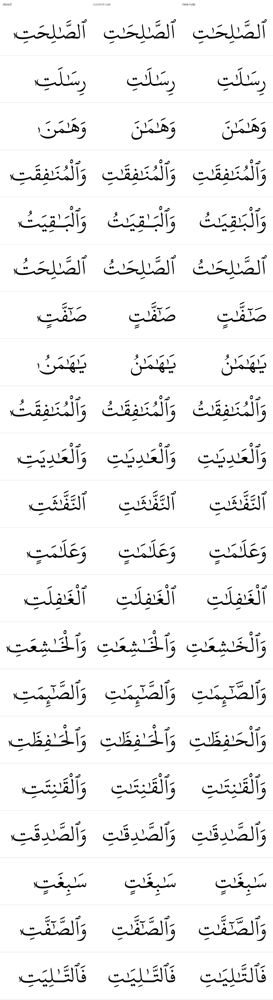

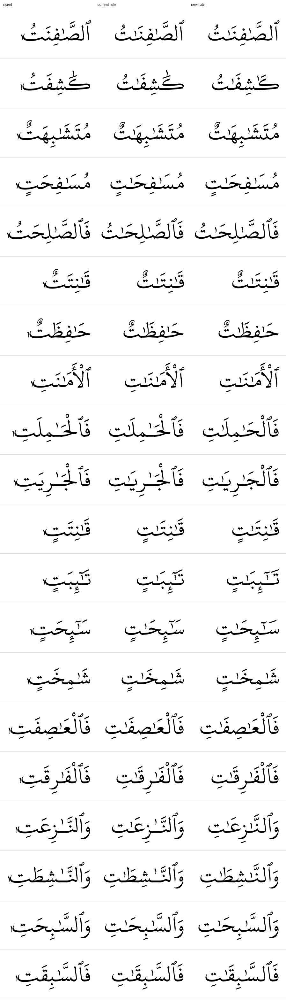

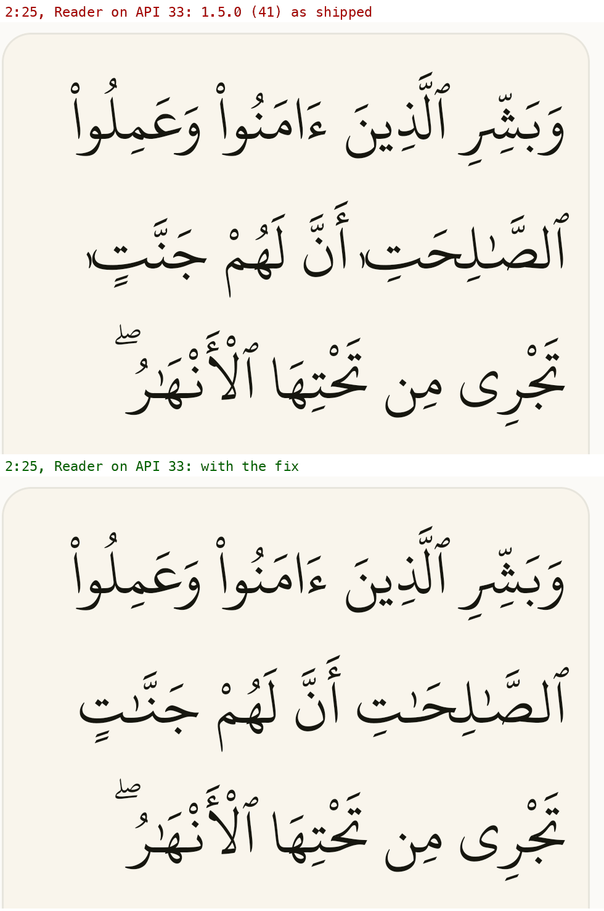

### What it changes on screen beyond the mark

Please look at this before deciding. The mark can't be moved alone.

- **Letter shapes.** In the touched words, the merged kashida glyph becomes the font's ordinary letter and final form, so the stretch before the last letter differs a little.
- **It makes one thing worse: the small low meem on 6 tokens** (14:3 ضَلَـٰلٍۭ ×3, 10:68 ×2, 18:15). The ordinary final form brings the letter's tail further into the meem: 15 % of the meem's ink overlapped becomes 35 % at 14:3, and 11 % becomes 25 % on the other two. The word still reads, and those words were already wrong before. They now look like the other low-meem words (see the iqlab item below). No other mark in the 322 words gets worse by 8 points or more.

  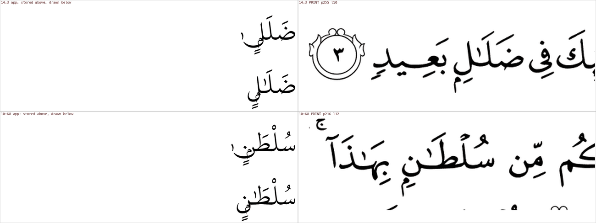
- **Word widths** change by −11.8 % to +17.6 % (mean −0.2 %), and a line's by −1.6 % to +3.0 %.
- **No page changes size or row height.** `layoutPage` still takes the page's size from the stored spelling, so `fitToHeight` gives the same answer everywhere. Without this, 8 to 19 pages would have moved by 0.5 sp on each phone width I computed.
- **Justified lines respace slightly.** The tightest gap in the Mushaf goes from 450 to 390 font units, 2,048 to the em (p.339 l.2). No gap goes negative. 54 lines are up to 1.1 % wider than the page's widest stored line, and their gaps take it in.
- **Three surah-ending lines** (p.331 l.14, p.261 l.15, p.551 l.6) would run past the frame by up to 3.4 dp, inside its 10 dp padding, so `placeWords` now closes their gaps by as much.
- **In the Reader, a word can wrap differently.** At 40 sp on the short phone, 31:11 now takes one line fewer, and everything below moves up. Nothing is cut or overlapped.

### Short phone and largest size

On API 33 at 408×760 dp and at font scale 2.0, before and after, pixel-compared on 9 Mushaf pages. These include the widest-growing pages (292, 350, 542) and the three surah-ending lines (261, 331, 551). Only the bands holding an affected word differ, every other line is pixel-identical at the same height, and nothing overlaps.

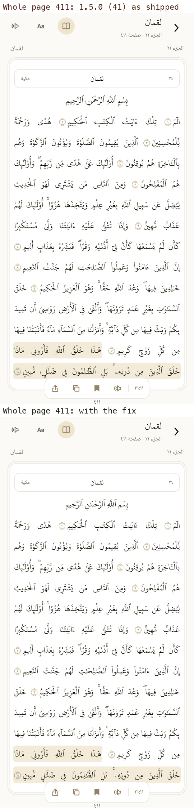

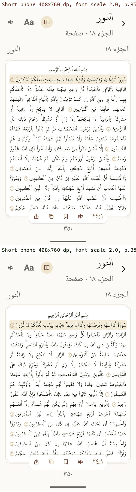

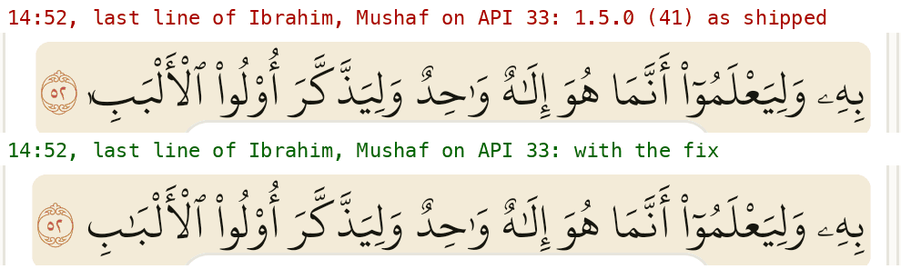

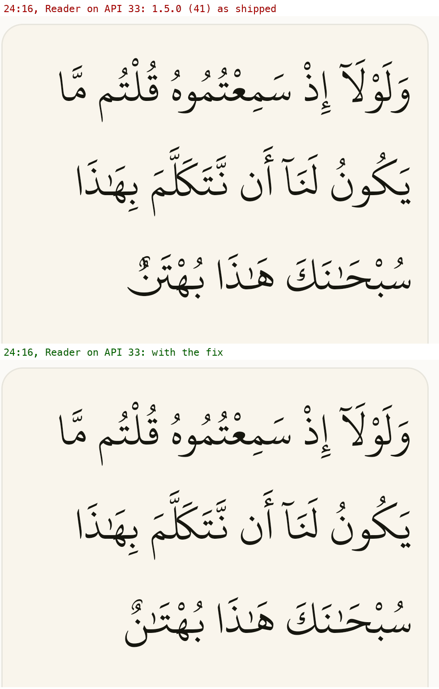

### Tests

- `HafsMarkPlacementDbTest` runs the whole Quran through the JDK's text layout against the real font and database, over every word, ayah, Mushaf line and Mushaf word. It failed on the old behaviour, and it fails if any alef rests on a kashida glyph. It also requires the rule and the font to agree in both directions (322 words, 1,333 tokens), checks that a touched word loses every tatweel before an alef and nothing else, checks that the stored text keeps its tatweel, and pins the 13 call sites file by file.
- `HafsSpellingTest` covers the rule itself and runs on iOS too. `MushafPageViewTest` gains the gap cap.
- Limit: the JDK runs with `liga` and `kern` off. The kashida glyphs come from `calt`, and the result was the same with default features when measured with HarfBuzz, but a fault that needs `liga` wouldn't show here.
- `scripts/test.sh` on the final rule: 4,652 tests, 0 failures, 0 skipped (Android host 2,316, iOS simulator 2,336). `scripts/ios-build.sh`: BUILD SUCCEEDED, the widget extension is 3 MB. The only change after that run is one comment's wording.

## Other differences from the print

**None of these is fixed here. All are on the stores today, and none comes from this branch** except the 6 low-meem tokens above. Root cause in one line: this font expects King Fahd's encoding of the Quran, and we feed it Tanzil's.

**What rests on what.** What the print looks like rests on the page images (see the limit above). What a sign *means* (the ring, stacked or staggered tanwin, the lozenge) rests on a reader's memory of the Mushaf's key, which nobody here has re-read. The counts are measured from `quran.db` and the King Fahd text. A qualified reader should settle anything below before it's acted on.

**Licence.** Fixing any of these means drawing a different mark or letter from the one stored, which no Tanzil file has. That is not the same kind of step as dropping a tatweel, and it can't honestly sit under a "Reproduced verbatim" credit. The King Fahd text would also be a second source, and I found no licence for it in the repo (the repo's King Fahd terms cover the font).

### Individual words

1. **2:72 فَٱدَّٰرَْٰٔتُمْ: can be misread.** Hamza and sukun disappear into a black blot on the ر, so a learner could read the word without its hamza, which would be a different word. There's no tatweel here, so this rule can't reach it. The King Fahd spelling (U+0621 U+06E1 for U+0654 U+0652) draws the hamza clearly in this font and looks like the print.

   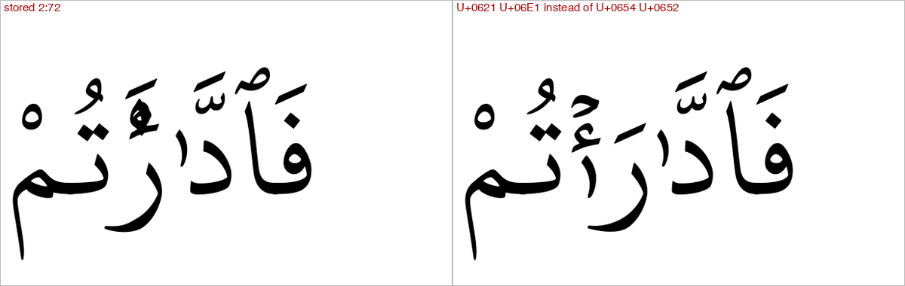

   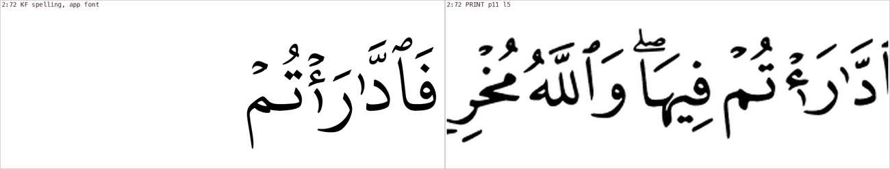

   **The same pile-up (U+0640 U+0654 U+0652) is in 18 more words**, 23 tokens, in 19 ayahs: 9:44, 9:45, 9:83, 9:86, 9:93, 10:49, 15:5, 15:24, 16:61, 23:43, 24:58, 24:59, 24:62, 28:26, 33:13, 33:51, 33:53, 34:30 and 70:13. The hamza stays more recognisable there, but the ring sits on it.

   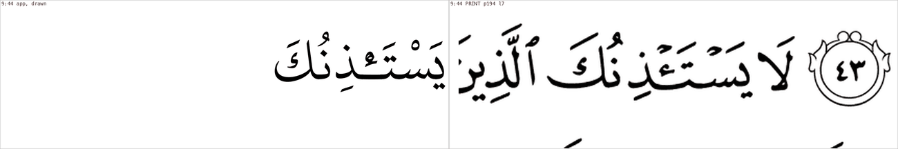

2. **52:37 ٱلْمُصَۣيْطِرُونَ: a big black dot in a dashed circle in the middle of the word.** The font has no real glyph for Tanzil's U+06E3, so it draws a placeholder. It's worse than it first looks: **the fatha of the ص attaches to that placeholder and disappears**, so the word loses a vowel as well as the small seen. The King Fahd spelling (U+06DC) draws the fatha and the small seen below the ص, as the print has it.

   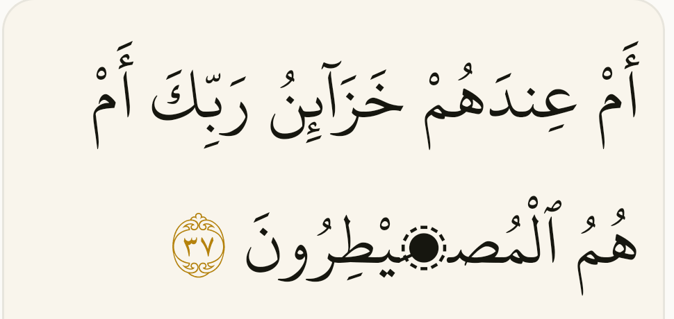

   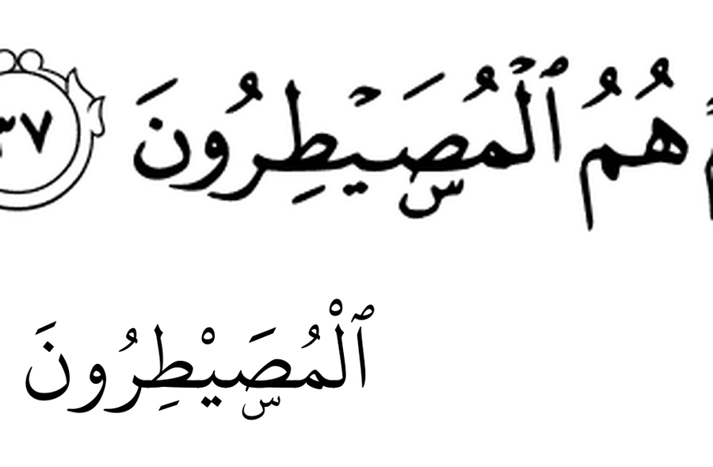

3. **12:11 تَأْمَ۫نَّا: the same dot in a dashed circle** (Tanzil's U+06EB). **An earlier version of this report said King Fahd's U+06EC draws properly here. It doesn't.** It draws a solid dot, while the print has a hollow lozenge (the sign of ishmam, as I understand it). Using it would replace an obviously broken mark with a clean-looking wrong one, the sign the print uses at 41:44.

   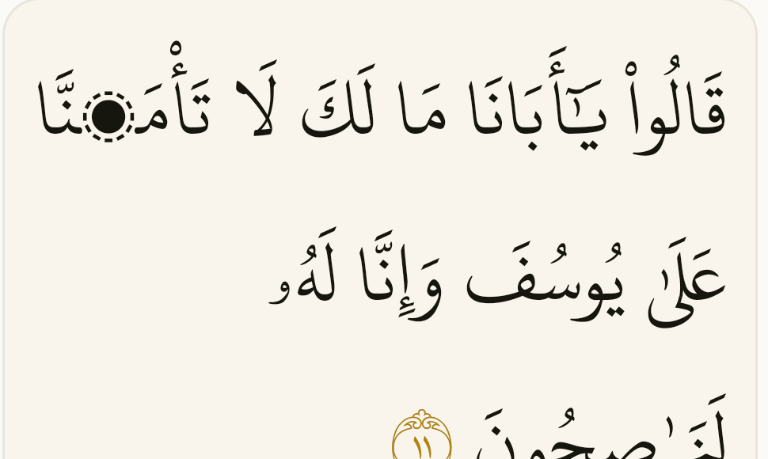

   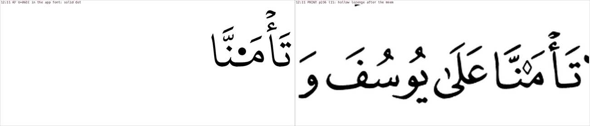

4. **11:41 مَجْر۪ىٰهَا: a solid dot where the print has a hollow lozenge** under the ر (the sign of imala, as I understand it; U+06EA occurs only here in our text). The King Fahd text has the same code point, so changing the spelling can't help. Only the print shows this. **This font may have no right glyph for 11:41 or 12:11.** The independent check found no hollow lozenge among the encoded marks or the 118 unencoded glyphs it rendered, of 1,555 custom-named glyphs.

   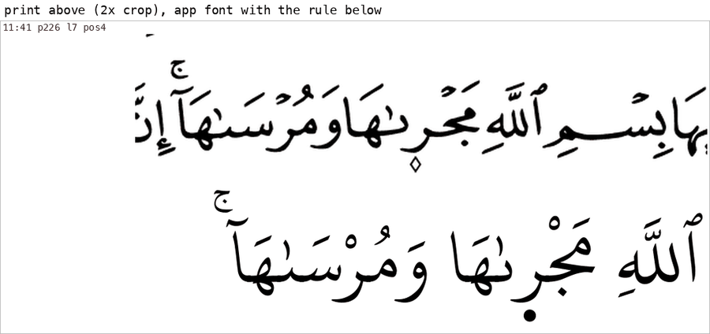

### Whole classes

5. **Iqlab: 209 words, 339 tokens.**
   - **High meem (240 tokens):** tanwin plus U+06E2, such as أَلِيمٌۢ (U+064C 134, U+064B 106). The print has one vowel plus the meem; the app stacks a full tanwin and the meem.
   - **Low meem (99 tokens, 66 words):** U+064D U+06ED, such as قَوْمٍۭ. This is the worse form: the meem is half overprinted and hard to find, with 44 tokens at 25 % or more of its ink overlapped. King Fahd's spelling draws it cleanly.
   - The earlier version counted only the high meem. The meem's position was proved correct in September, but the shape isn't what the print shows.

   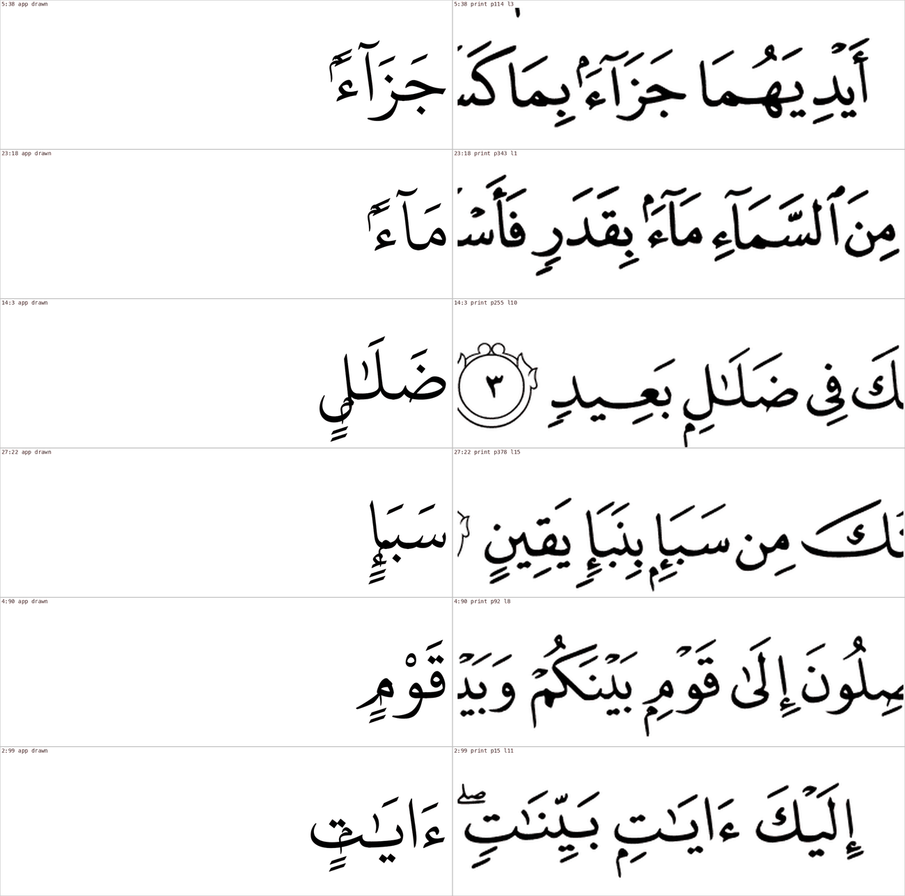

6. **Every sounded sukun draws as a ring: 37,148 marks.** The print uses a small head of kha for a sounded letter and keeps the ring for a silent one. This font has both (U+06E1 and U+0652). Our text has only U+0652, for both kinds. So the waw of أَوْ carries the same sign as the silent waw of أُوْلَـٰٓئِكَ. Most readers still read correctly, but the sign exists to prevent that error. It's visible in every image in this report, including بِسْمِ in the basmala.

7. **All staggered tanwin draw stacked: about 6,640 marks.** The print staggers them where the sound assimilates or is concealed, and stacks them where it's pronounced clearly. King Fahd has dedicated code points (U+0657, U+0656, U+065E); Tanzil doesn't. It doesn't change the letters read, but the tajweed signal is lost. It's on the reader's own word.

   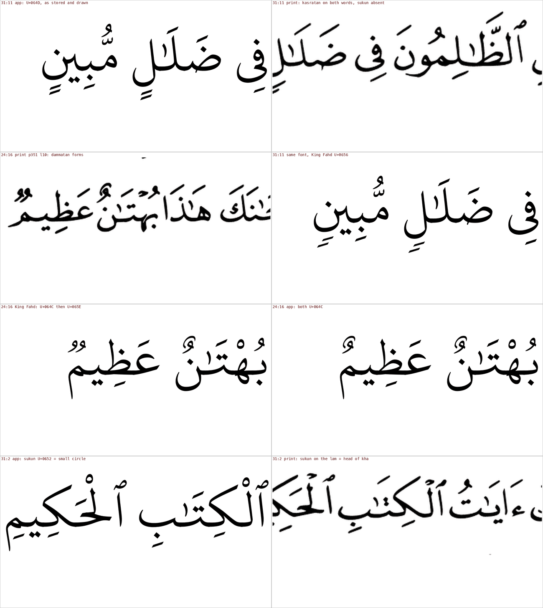

8. **277 tokens (48 words) lack the lam-alef ligature.** Where a lam comes before a hamza and alef, such as ٱلْـَٔايَـٰتِ, the print has the ligature with hamza and madda, and the app draws lam, a kashida with the hamza, then alef. It reads the same. 62 of the fix's own tokens are among them, so on these the "after" has the alef right but doesn't match the print in shape.

   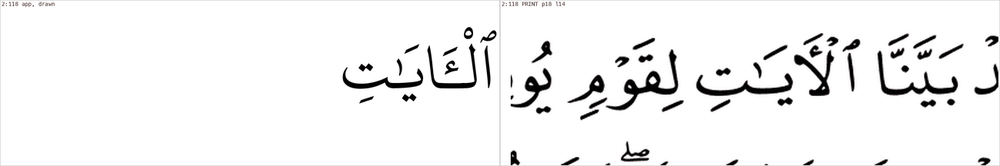

**Smaller crowdings, legible and left alone:** madda across ط's stem in 6 words, and fatha touching madda on يَـٰٓ in 190 tokens.

### Outside the app

The website's `site/assets/img/mushaf-arabic.webp` shows the stray tick on ٱلرَّحْمَـٰنِ at 1:1 and 1:3, and the store's Quran shots (3, 4, 5, 9) show the stray marks. I didn't view `mushaf.webp`.

*Correction, 7 November:* of the store's Quran shots only shot 4 (Mushaf page 42: دَرَجَـٰتٍ and ٱلْبَيِّنَـٰتِ on line 2, ٱلْبَيِّنَـٰتُ on line 4, all 2:253) carried stray marks. Shots 3, 5 and 9 show only 2:255 and the tail of 2:254, which hold no word the rule touches, and are clean. Shot 4 in both stores and all seven languages, and the five site and README images that show the basmala (`mushaf`, `mushaf-arabic`, `adhkar`, `adhkar-arabic`, `recitation`), were re-shot on `release-1.5.1-shots` (2f4f1667).

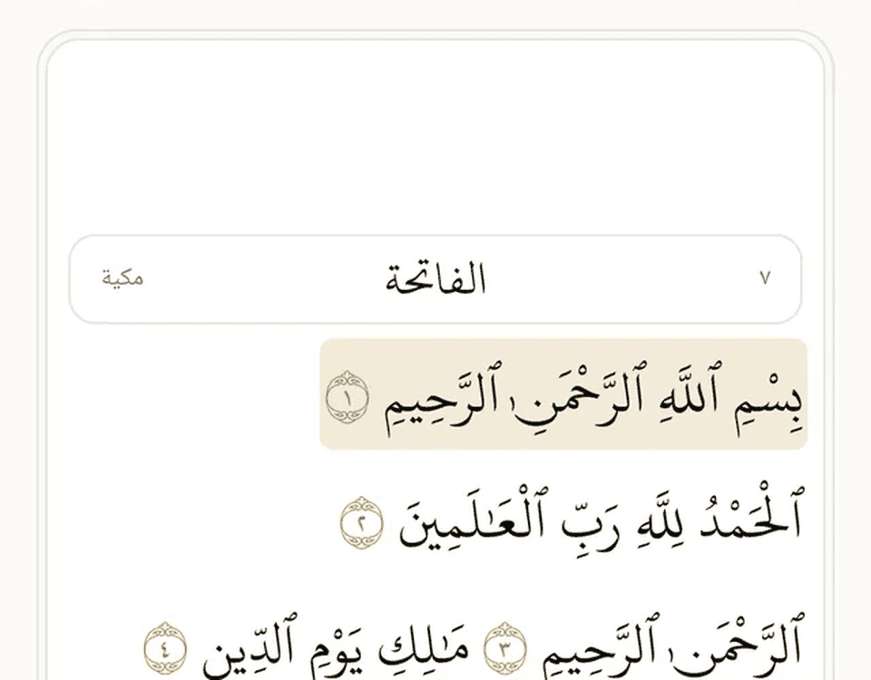

## What was and wasn't verified

**Verified:**

- on a new API 33 phone emulator (`Quran_API33`, ar-EG, port 5580) running 1.5.0 (41)'s code and the final fix, zoomed before and after
- on my own simulator (`Quran-31-11`, iOS 26.2) on the final build; "before" for iOS is the App Store screenshot
- two independent checks. One reproduced the mechanism and counts and caught the 13 tokens my first rule missed. The Lead's reproduced the counts four ways, and read all 322 words by eye and about 60 against page images (before the two-tatweel change; I read those 41 again by eye, and the rest draw identically)

**Not verified:**

- **The reader's OPPO CPH2203 / ColorOS.** I have no such device. Everything draws through the bundled font, so nothing points to the phone, but I haven't seen this on one.
- **Any physical phone.** The rules kept this work off them. Mohamed's usual S23 and iPhone 12 smoke test still applies.
- **The real iOS home-screen widget.** I saw the debug preview route with a forced seed, which runs the same SwiftUI view.
- **All 322 words against the print.** About 60 were compared with page images. On all aligned words the King Fahd text puts the alef after the same letter (the Lead's check).
- **A qualified reader.** No hafiz or Quran specialist has reviewed the rendering or the differences above.
- **The new test on Linux.** It's the repo's only `java.awt` use and has only run on this Mac. On Ubuntu, a failure would turn `main`'s Tests red and can stop the private monitor's weekly publish. I expect it to pass, but that's an inference from package lists. So the order is: **with your OK, push the branch first and let CI run it, then merge to `main`.**

## Decisions for Mohamed

1. **Merge this fix?** Look at the images above. It changes the stretch before the last letter in those words and worsens the low meem on 6 tokens. It merges cleanly onto `watch-companion`, so it can ship in 1.6.0 (42).
2. **Ship sooner than 1.6.0?** The basmala is wrong on 112 surahs, on both stores, today. The fix also applies cleanly to `main`, so a patch release is possible.
3. **The "Reproduced verbatim" credit has been untrue since September, independently of this branch.** It's in `credit_quran_text_detail` in the app's seven languages, `docs/ATTRIBUTION.md:24` and `NOTICE:8`. The stored text, which copy and share hand out, has 3,988 substituted marks, and the notice we ship from Tanzil says "CHANGING IT IS NOT ALLOWED". The choices are to correct the credit and declare the mapping, ask Tanzil, or both. My reading, not legal advice: dropping a tatweel on screen is low risk, since Tanzil publishes that form itself, but the credit should say what we do.
4. **The word-level defects, most serious first:** 2:72 and its 18 siblings, 52:37, then 12:11 and 11:41, where this font may have no right glyph. Each draws a mark no Tanzil file has, so this depends on decision 3.
5. **The bigger question behind the whole list:** whether the app should keep drawing Tanzil's encoding in this font at all. Moving to the King Fahd text would address the sukun, the staggered tanwin, iqlab and the ligatures together, but it's a new source with unknown terms and a change to every page. Rebuilding from Tanzil's no-tatweel form, as our spec intended, is smaller, but it fixes none of that, and it reshapes about 1,440 tokens that already draw correctly. I'm not recommending either now.
6. **Store screenshots and the website image** need re-shooting at the next cut. *Done 7 November on `release-1.5.1-shots` (2f4f1667), see the correction under Outside the app.*

The reply below should only go after the fix is on its way.

## Draft reply to the reader (not sent)

> وعليكم السلام ورحمة الله وبركاته،
>
> جزاكم الله خيرًا على هذا التنبيه الكريم، ونعتذر إليكم عن هذا الخطأ. راجعنا الآية ١١ من سورة لقمان فوجدنا ما ذكرتموه: الألف الصغيرة في كلمة «ضَلَـٰلٍ» موجودة في نص التطبيق، لكن التطبيق كان يُظهرها على الشاشة خارج الكلمة، فتبدو كأنها «ضللٍ». فالخلل في طريقة العرض على الشاشة لا في نص القرآن.
>
> ولا يقتصر هذا على هذه الكلمة، بل يشمل كلمات كثيرة فيها هذه الألف، منها «ٱلرَّحْمَـٰنِ» في البسملة. وقد أعددنا إصلاحًا لهذه الألف سيصل في تحديث للتطبيق إن شاء الله. ونواصل مراجعة علامات أخرى في عرض المصحف مقارنةً بالمصحف المطبوع، فقد تبقى فروق في بعض العلامات.
>
> نشكر لكم حرصكم على كتاب الله، ونسأل الله أن يجعل ذلك في ميزان حسناتكم.
